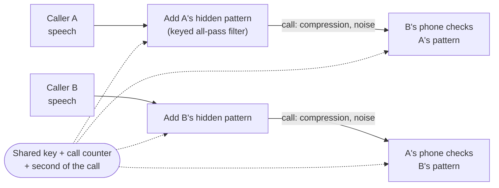

# Phase-Auth

**Both sides of a voice call prove who they are, with a pattern no one can hear.**

Phase-Auth hides a secret, time-varying pattern in the *phase* (the timing) of each caller's own speech. A key shared by
the two phones decides the pattern for every second of the call, and each phone checks the other's pattern for the
whole call. A cloned voice, a recording of an old call or your own voice played back to you carries the wrong
pattern, so the check fails.

> **Status:** research project in progress (CS 568 Speech Processing, TED University, Fall 2026).
> The method and evaluation plan are fixed; the code is being written. Nothing here is a finished security product.

## How it works



1. **Carrier.** An all-pass filter changes only *when* each frequency arrives, never how loud it is. Kept below
   published hearing thresholds, the change is meant to be inaudible.
2. **Key.** For every window of about one second, a keyed hash (HMAC) of the shared key, the call counter, the
   direction (A→B or B→A) and the window number picks the filter. Without the key, nobody can produce the next pattern.
3. **Check.** The receiver removes the voice's own shaping with linear prediction (LPC), reads the phase with the
   short-time Fourier transform (STFT) and compares it with the pattern it expects. The caller is accepted while
   enough recent windows match.

## What it defends against

| Attack | Why it fails |
|---|---|
| Cloned or synthetic voice | No key, so no correct pattern |
| Replay of an old call | Patterns change every call and every second |
| Reflection (your own voice sent back) | Each direction uses a different pattern |
| Removing the pattern | Nothing is verified, so the phone warns |

Out of scope: an attacker in the middle who relays the real person's live voice.

## Evaluation (planned)

- **Speech:** LibriSpeech, with separate speakers for tuning and testing; MUSAN noise and simulated room echo.
- **Channels:** Opus, AMR-NB and G.722 at several bit rates, packet loss and delay.
- **Measures:** PESQ, ViSQOL and STOI for audio quality, a small ABX listening test for inaudibility, equal error
  rate and time to decision for detection, and the false-accept rate of each attack.
- **Detectors:** a correlation baseline against the proposed detector.

## Repository layout (planned)

```
phase_auth/      carrier, key schedule, embedder and detectors
channels/        codec, noise and packet-loss simulation
experiments/     scripts that produce every table and figure
tests/           unit tests for the key schedule, filters and metrics
```

## Getting started

Setup instructions will be added with the first release of the code.

## Author

Umay Şamlı, TED University. The project idea came from the CS 568 course advisor.

## License

To be decided before the first release.
